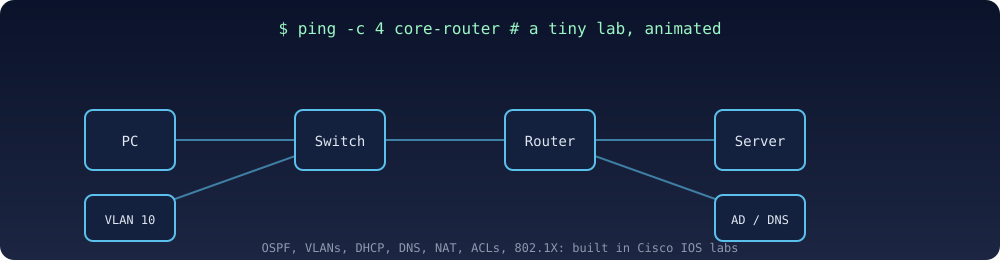

  

  

  
  
  

## About me

IT support and network engineering student at Al-Balqa Applied University (BEng, expected March 2027), based in Irbid, Jordan. I spent a year in technical support on a live airline reservation system, I run a small IT and web company ([Nixas Link](https://nixas.link)), and I'm building an AI-assisted Windows sysadmin assistant as my graduation project. I am looking for junior and internship roles in IT support, systems administration, cloud and networking, remote or on-site. I plan to move to Manchester, UK in June 2027.

## Tech I work with

  

- **Systems:** Linux (Red Hat training), Windows Server, Active Directory, Group Policy, PowerShell, Bash
- **Networking:** Cisco IOS labs with VLANs, inter-VLAN routing, OSPF, DHCP, DNS, NAT, ACLs and 802.1X
- **Cloud and tools:** AWS fundamentals, Azure virtual machines and resource groups, Docker, Git
- **Code:** Python (FastAPI, SQLAlchemy), SQL, JavaScript, C++

## A tiny lab, animated

  

## Projects

| Project | What it is |
|---|---|
| **[AI System Administration Assistant](https://github.com/Superman247/ai-sysadmin-assistant-showcase)** | Graduation project. An AI proposes an action, fixed policy rules check it, and risky actions wait for a second administrator to approve. Every action goes into a hash-chained audit log. FastAPI, PostgreSQL in Docker and an Arabic/English dashboard. It runs as a simulator; changes to real Active Directory are disabled until it is validated in an isolated lab. Source is private for now. |
| **[Nixas Link](https://nixas.link)** | My small IT, networking and web company in Jordan. I built and host the site (Next.js, PostgreSQL) on a DigitalOcean server. |
| [cpp-practice](https://github.com/Superman247/cpp-practice) | C++ course exercises. |
| [My-Web-Projects](https://github.com/Superman247/My-Web-Projects) | Early web development practice. |

## Training

Red Hat RH124, RH134, RH104 and AD141 (course attendance), AWS Cloud Practitioner Essentials course. Planned: CCNA, Microsoft Azure and AWS certification exams.

## GitHub streak

  

## Contact

  
  

